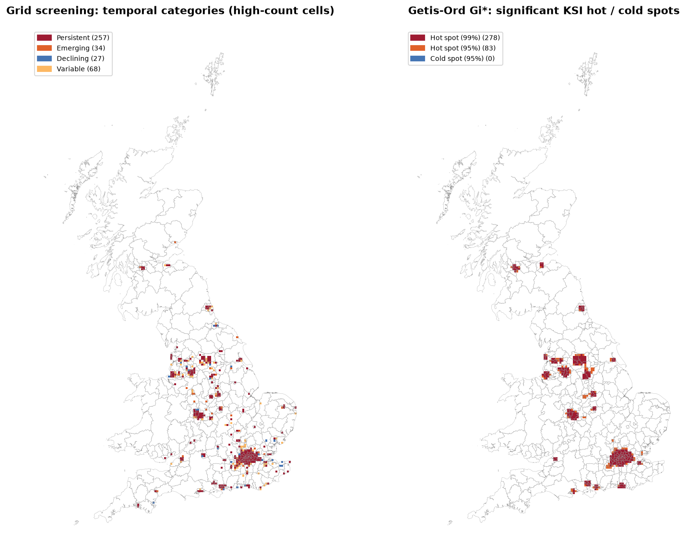

# Spatiotemporal Hotspot Analysis and Severity Prediction of Road Accidents
### using Apache Sedona and Spark MLlib

**Spatial Big Data · Lanka Priya (253305) · MSc Data Science and Geoinformatics, Digital University Kerala**

Where, when and why do severe road crashes cluster in Great Britain, and which conditions make a crash severe?
This project analyses **513,745 geo-located police-reported collisions (UK DfT STATS19, 2021–2025)** with a
distributed spatial pipeline (Apache Spark 3.5 + Apache Sedona 1.7). It delivers the results as an interactive
Streamlit dashboard.



## Pipeline

| Step | What is done | Tools |
|---|---|---|
| 1 Clean | duplicates, coordinate validity, date/time parsing, missing codes | Spark SQL |
| 2 Store | Sedona point geometries (WGS84 + British National Grid), **KDB-tree spatial partitioning + R-tree index**, GeoParquet, PostGIS | Sedona, PostGIS |
| 3 Wrangle | **Sedona point-in-polygon join** to 363 local authority districts, 5 km grid, **H3** hexagons, hour/season/time-band features | Sedona |
| 4 Model | Grid screening, **Getis-Ord Gi\***, **K-Means**, **DBSCAN** hotspots · **Random Forest / GBT / Logistic Regression** severity models · **FP-Growth** association rules | Sedona `stats`, Spark MLlib |
| 5 Deliver | interactive map dashboard | Streamlit, pydeck, Plotly |

## Key results

| Question | Finding |
|---|---|
| Where do severe crashes cluster? | **278 + 83** statistically significant KSI hot-spot cells (Gi\*, 99 % / 95 %, FDR-corrected) in London, the West Midlands, Manchester, West Yorkshire and Glasgow; **257** persistent high-count 5 km cells; **114** DBSCAN clusters of fatal crashes and **186** junction-scale KSI clusters |
| Which areas are most fatal? | Most fatal crashes by count: Birmingham. Highest fatality *rate*: Aberdeenshire (78 per 1,000 collisions), Highland (71), Gwynedd (58), against a GB average of 14.7 |
| When? | Volume peaks in the weekday 15:00–18:00 commute; **KSI share is highest at night (30.5 %) and weekends**; KSI share rose from 22.5 % (2021) to 26.2 % (2025) |
| Which conditions? | Fatal is **3.9× more likely** for *rural + not at junction + darkness without lighting* and **3.7×** for *A-road + single carriageway + 60 mph* (FP-Growth lift) |
| Can severity be predicted? | Class-weighted Random Forest on unseen 2025 data: **macro F1 0.346, fatal recall 55 %** (baseline 0 %), but fatal precision about 4 %. District-level predicted risk tracks observed 2025 KSI share (**Spearman ρ = 0.66**) |
| Spark vs Sedona | Sedona spatial join **about 3× faster** than a hand-written Spark UDF and close to GeoPandas on 0.5 M points (single machine) |

## Dashboard features

| Proposal (slide 5) | In the dashboard |
|---|---|
| Hotspot map: heatmap and cluster layers, zoom, click popups | 🗺️ Hotspot map: heatmap, 3D hexagons, KSI points, Gi\* cells, K-Means centres, DBSCAN cluster hulls; click a cluster for a detail panel |
| Time controls | sidebar: year range, hour range, day of week, month, season |
| Condition filters | sidebar: severity, weather, road type, junction, light, surface, road class, urban/rural, speed limit, district |
| Severity predictor | 🎯 enter conditions → class probabilities, risk level and percentile against 2025 collisions |
| Rule explorer | 🔗 filter rules by condition (rain, darkness, motorway, rural, night…), consequent, lift, rule length |
| Linked charts | every chart and KPI follows the filters; clicking a map cluster shows charts for that cluster |
| (extra) Fatal & risk areas | ⚠️ district choropleth: fatal count, fatal rate, KSI %, predicted risk index; H3 predicted vs observed |

## Repository contents

```
app.py                         Streamlit dashboard
requirements.txt               dashboard dependencies (Streamlit Cloud installs these)
requirements-notebook.txt      analysis dependencies (Spark, Sedona, …)
.streamlit/config.toml         dashboard theme
notebooks/Road_Accident_Spatiotemporal_Severity.ipynb   full analysis, executed, with outputs
data/dashboard/                compact files read by the dashboard (~13 MB)
outputs/figures/               all figures
documentation/                 model metrics, rules, benchmark, data-quality summary
DEPLOYMENT.md                  how to upload to GitHub and deploy on Streamlit
LICENSE_DATA.md                data sources and licences
```

## Run it

**Dashboard (any OS):**
```bash
pip install -r requirements.txt
streamlit run app.py
```
**Analysis notebook** (Java 17, Python 3.11; Linux, WSL2, Windows or the DGX):
```bash
pip install -r requirements-notebook.txt
jupyter lab notebooks/Road_Accident_Spatiotemporal_Severity.ipynb
```
The raw data (115 MB) are downloaded automatically on first run. On Windows, Spark also needs Hadoop's
`winutils.exe` and `hadoop.dll` in `C:\hadoop\bin`. See [DEPLOYMENT.md](DEPLOYMENT.md) for details.

## Limitations
* No traffic-exposure data: hotspots reflect traffic volume as well as danger.
* Severity recording differs between police forces (CRASH system). This is partly why `police_force` is a strong predictor.
* Scene conditions (light, weather, surface) are recorded after the crash, so the model is not a validated pre-crash predictor.
* Hotspot results depend on grid size, Gi\* neighbourhood and DBSCAN parameters.
* Association rules show co-occurrence, not causation.
* In the submitted run, the PostGIS step was skipped (no database server running). The code loads PostGIS whenever `POSTGIS_URL` points to a reachable server.

## Data
UK Department for Transport, *Road Safety Data* (STATS19), and ONS *Local Authority Districts (December 2021)*, both
under the Open Government Licence v3.0. See [LICENSE_DATA.md](LICENSE_DATA.md).
